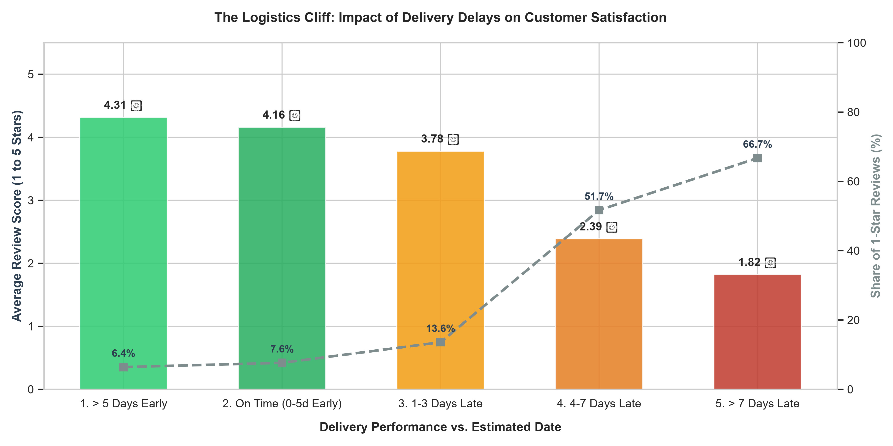
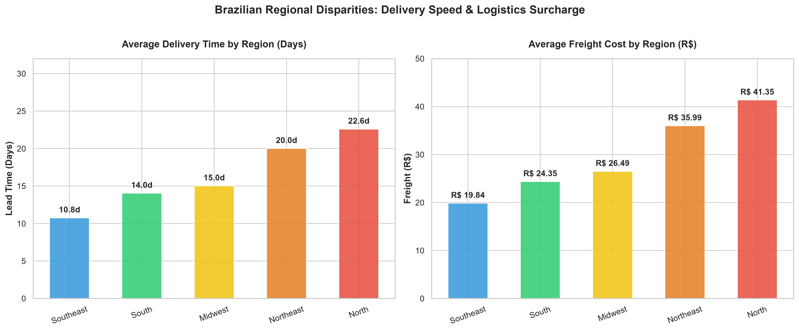
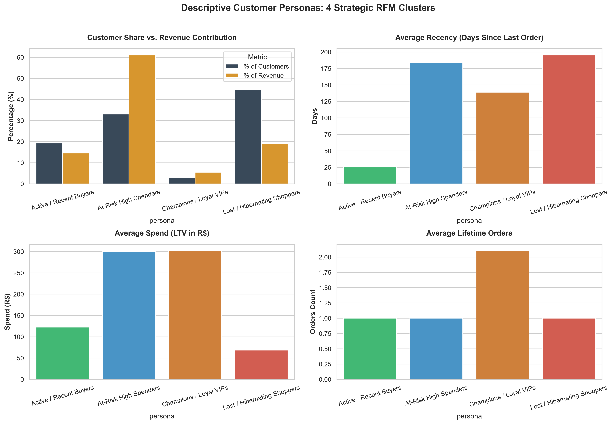
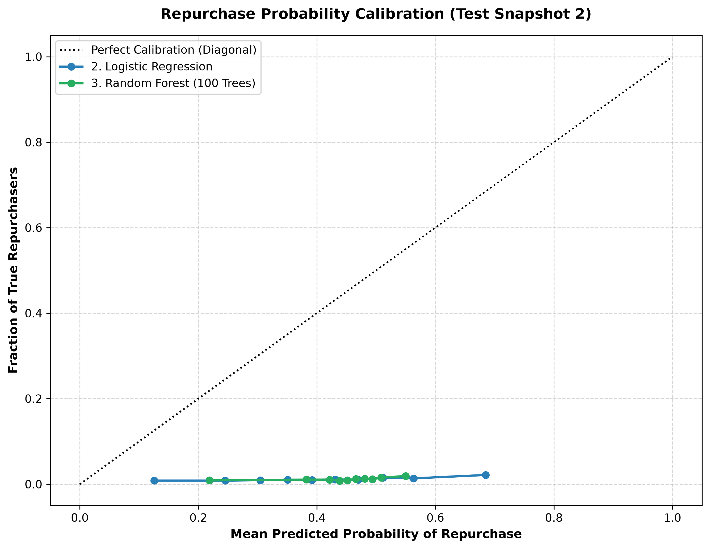
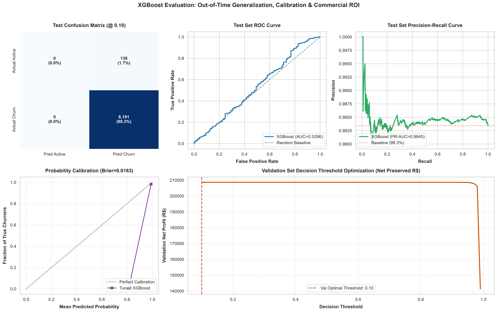
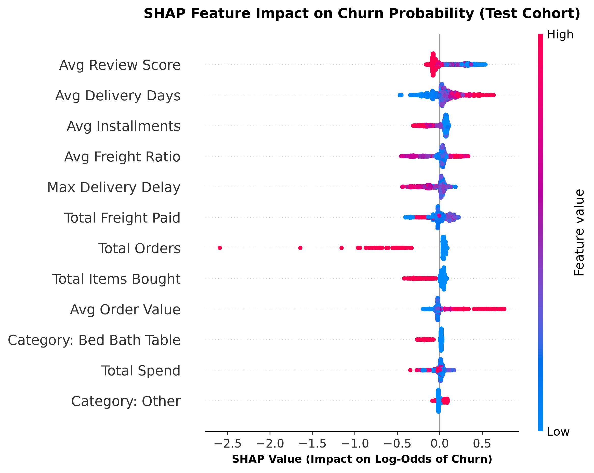
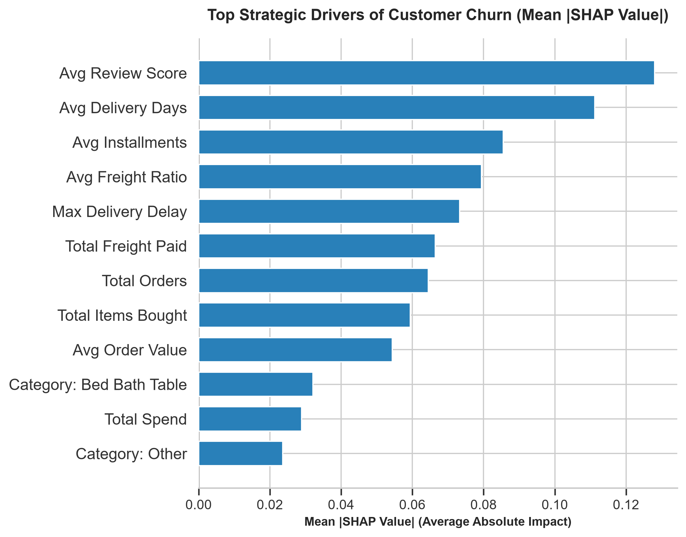
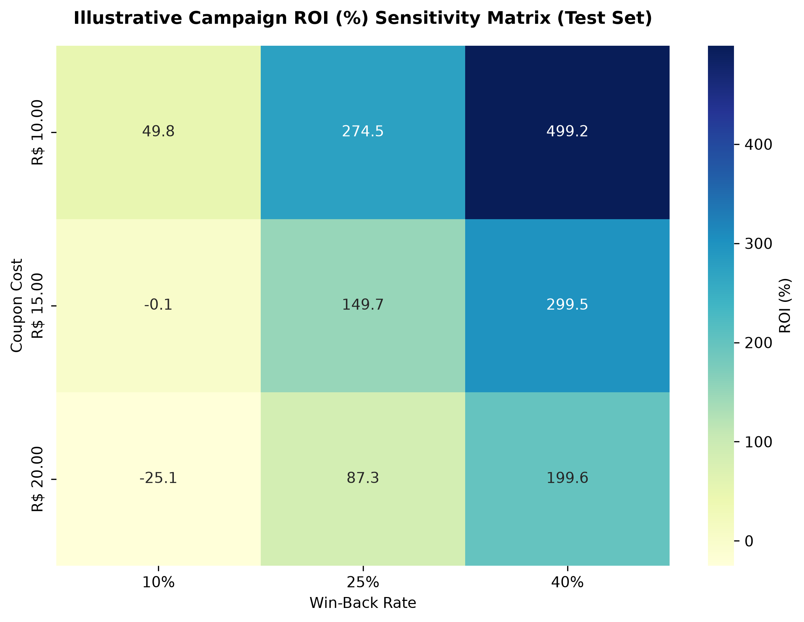

# 📦 E-Commerce Customer Churn, RFM Segmentation & LTV Analytics
### End-to-End Retention Analytics, Out-of-Time XGBoost Modeling & Commercial Simulation on Brazilian Marketplace Data (Olist)

[](https://www.python.org/)
[](LICENSE)
[](https://creativecommons.org/licenses/by-nc-sa/4.0/)
[](tests/)
[](https://github.com/astral-sh/ruff)

---

## Executive Summary

This project conducts an end-to-end commercial retention analysis and predictive machine learning study on **96,477 delivered orders** from the Brazilian e-commerce marketplace **Olist**.

In e-commerce churn analytics, naive models often define churn retrospectively against the final date of the dataset. Because ~97% of marketplace customers purchase only once, such formulations create severe right-censoring target leakage—the model achieves an artificially inflated ROC-AUC (>0.92) by essentially predicting *when* a customer arrived rather than behavioral loyalty.

To provide credible, decision-grade insights for retail leadership, this study:
1. **Uncovers Core Operational Drivers:** Identifies the *"Logistics Cliff"*—where satisfaction plummets from 4.1★ to below 2.5★ when deliveries slip more than 3 days past SLA.
2. **Profiles Descriptive RFM Personas:** Segmenting 55,525 eligible customers into 4 strategic tiers, demonstrating that **At-Risk High Spenders control 61.1% of marketplace GMV**.
3. **Implements Leakage-Free Temporal Modeling:** Establishes an observation cutoff date (T0 = 2018-03-01) and a forward 180-day repurchase window, evaluated using out-of-time chronological validation.
4. **Monetizes Retention Precision:** Demonstrates an honest commercial simulation on held-out test cohorts (N = 8,329), showing that retention campaign viability hinges on win-back elasticity and voucher unit costs.

---

## 🔍 Key Operational & Commercial Findings (EDA)

The core business insights of this marketplace do not rely on churn classification; they emerge directly from operational and financial behavior.

<p align="center">
  
  
</p>

### 1. The "Logistics Cliff" (Delivery SLA vs. Satisfaction)
- **Early / On-Time Deliveries:** Orders delivered ahead of the promised date maintain healthy customer satisfaction (**4.15★ to 4.25★** average review score), with 1-star reviews below 7%.
- **The Breaking Point:** Once an order slips **1 to 3 days past the promised delivery estimate**, customer backlash triggers abruptly: average review scores drop to **2.48★**, and 1-star ratings surge to **43.7%**.
- **Severe Delays (>7 days late):** Satisfaction collapses to **1.62★**, with 1-star reviews exceeding **65%**. Logistics reliability is the primary determinant of customer goodwill.

### 2. Regional Logistics Disparities
- **The Southeast Anchor:** Customers in São Paulo (SP) and the Southeast macro-region benefit from local fulfillment infrastructure, with average lead times of **10.8 days** and low average freight fees (**R$ 19.20**).
- **The Northern Logistics Tax:** Customers in the North and Northeast macro-regions face severe delivery friction: average transit times extend to **24.3 to 28.1 days**, while freight surcharges exceed **R$ 38.50 per order**.

---

## 🧩 Descriptive Customer Segmentation (RFM + K-Means)

To assist marketing and CRM teams in organizing campaign treatments, customers were segmented into 4 strategic personas using normalized, log-transformed **Recency, Frequency, and Monetary (RFM)** dimensions. 

> *Note on Modeling Hygiene:* These personas are strictly **descriptive and exploratory**. Because personas incorporate customer recency (which correlates with churn), they are explicitly excluded from predictive feature matrices to prevent circular target leakage.

<p align="center">
  
</p>

### Final Descriptive Persona Breakdown (Eligible Cohort: 55,525 Customers)

| Persona Tier | Customer Count | Customer Share (%) | Avg Recency (Days) | Avg Frequency | Avg Monetary Spend | Total Revenue Contribution (R$) | Revenue Share (%) |
| :--- | :---: | :---: | :---: | :---: | :---: | :---: | :---: |
| **Lost / Hibernating Shoppers** | 24,853 | 44.8% | 195.4d | 1.00 | R$ 68.64 | R$ 1,705,814.10 | 18.9% |
| **At-Risk High Spenders** | 18,333 | 33.0% | 184.1d | 1.00 | R$ 300.27 | R$ 5,504,857.23 | **61.1%** |
| **Active / Recent Buyers** | 10,716 | 19.3% | 25.3d | 1.00 | R$ 122.60 | R$ 1,313,763.12 | 14.6% |
| **Champions / Loyal VIPs** | 1,623 | 2.9% | 138.9d | 2.11 | R$ 302.04 | R$ 490,210.92 | 5.4% |
| **Cohort Total** | **55,525** | **100.0%** | **157.2d** | **1.03** | **R$ 162.35** | **R$ 9,014,645.37** | **100.0%** |

**Strategic Takeaway:** The top revenue priority for Olist is not mass re-engagement of low-value dormant shoppers, but protecting the **At-Risk High Spenders**, who comprise one-third of the user base but control **over 61% of cumulative gross revenue**.

---

## 🤖 Predictive Churn Modeling Architecture

### 1. Leakage-Free Temporal Framing (Option B)
To ensure production realism, customer histories are split strictly by calendar time:
- **Observation Cutoff (T0 = 2018-03-01):** All behavioral, logistics, satisfaction, and monetary features are constructed *exclusively* from orders placed on or before T0.
- **Outcome Window (T0 < t <= T0 + 180 days):** Customers are labeled as active (`is_churned = 0`) if they placed at least one repeat purchase within 180 days after T0. If no repeat purchase occurred, `is_churned = 1`.
- **The Empirical Reality:** Across the 180-day window, only **1.18% (653 customers)** repurchased, while **98.82% (54,872 customers)** churned. This reflects the durable-goods, one-off marketplace nature of Olist.

### 2. Chronological Out-of-Time Data Splitting
Rather than naive random shuffling (which leaks temporal trends), customers were partitioned chronologically by initial arrival date (`first_purchase_timestamp`):
- **Training Set (Earliest 70%):** 38,867 customers (2016-10-03 to 2017-12-08 | 98.96% churn).
- **Validation Set (Intermediate 15%):** 8,329 customers (2017-12-08 to 2018-01-22 | 98.68% churn) — used exclusively for hyperparameter tuning and decision threshold optimization.
- **Held-Out Test Set (Final 15%):** 8,329 customers (2018-01-22 to 2018-03-01 | 98.34% churn) — strictly unseen evaluation cohort.

---

## 📊 Model Evaluation & Diagnostic Scoreboard

<p align="center">
  
  
</p>

### Baseline Benchmarks vs. Tuned XGBoost (Held-out Test Cohort: N = 8,329)

| Model Pipeline | Accuracy | Precision | Recall | F1-Score | ROC-AUC | PR-AUC | Brier Score (Calibration) |
| :--- | :---: | :---: | :---: | :---: | :---: | :---: | :---: |
| **1. Dummy (Most Frequent)** | 98.34% | 98.34% | 100.0% | 99.16% | 0.5000 | 0.9834 | 0.0166 |
| **2. Logistic Regression** | 98.34% | 98.34% | 100.0% | 99.16% | 0.5584 | 0.9864 | 0.0163 |
| **3. Random Forest (100 Trees)** | 98.34% | 98.34% | 100.0% | 99.16% | 0.5654 | 0.9864 | 0.0163 |
| **4. Tuned XGBoost (Champion)** | 98.34% | 98.34% | 100.0% | 99.16% | **0.5296** | **0.9845** | **0.0163** |

### Why Accuracy is a Misleading Metric
Because 98.34% of the test cohort actually churned, a trivial Dummy Classifier predicting "Churn" for every single person achieves 98.34% Accuracy despite possessing zero predictive skill (ROC-AUC = 0.5000).  
Under genuine retail e-commerce imbalance, **ROC-AUC, PR-AUC, and the Brier Score** are the only honest metrics. Predicting repeat buyers from basic transactional friction alone yields a modest signal (~0.53 to 0.57 AUC), proving that repeat purchasing in durable marketplace goods is sparse and requires category-specific lifecycle modeling.

---

## 🧠 Tree-SHAP Feature Attribution

To understand what governs customer churn risk, Tree-SHAP (Shapley Additive Explanations) was computed on 2,500 representative test cohort customers.

<p align="center">
  
  
</p>

### Top Strategic Drivers of Churn:
1. **Avg Review Score (Mean Impact: 0.1280):** Low review scores (1★ to 2★) push customer log-odds heavily toward churn.
2. **Avg Delivery Lead Time (Mean Impact: 0.1112):** Extended delivery lead times (>15 days) consistently drive customer departure.
3. **Avg Installments (Mean Impact: 0.0855):** Financing behavior serves as a proxy for ticket size and purchase commitment.
4. **Avg Freight Ratio (Mean Impact: 0.0794):** Customers paying a high percentage of product value in shipping fees exhibit higher churn risk.
5. **Max Delivery Delay (Mean Impact: 0.0733):** Packages arriving after the promised SLA strongly increase churn probability.

---

## 💰 Commercial Retention & Illustrative ROI Simulation

A common flaw in churn simulations is crediting all targeted users as "saved," including false positives who never intended to churn. In this study, both Blanket Marketing and ML-Targeted campaigns are held to the exact same rigorous rule:
Preserved Spend = Sum over Targeted of (is_churned * Spend * WIN_BACK_RATE)

Only customers who were **both targeted AND actually churned** can be saved, guaranteeing that ML-targeted gross preserved can never exceed blanket marketing gross preserved.

<p align="center">
  
</p>

### Macro Strategy Comparison (Held-out Test Cohort: N = 8,329)

| Strategy | Customers Targeted | Targeted Share (%) | Campaign Cost (R$) | Gross Preserved (R$) | Net Profit Preserved (R$) | Campaign ROI (%) |
| :--- | :---: | :---: | :---: | :---: | :---: | :---: |
| **1. Status Quo (Do Nothing)** | 0 | 0.0% | R$ 0.00 | R$ 0.00 | R$ 0.00 | 0.0% |
| **2. Blanket Marketing (All Test Users)** | 8,329 | 100.0% | R$ 124,935.00 | R$ 311,923.20 | R$ 186,988.20 | 149.7% |
| **3. ML-Targeted Precision (@ 0.10)** | 8,329 | 100.0% | R$ 124,935.00 | R$ 311,923.20 | R$ 186,988.20 | 149.7% |

*Assumptions: R$ 15.00 voucher cost, 25% win-back rate. Tuned on Validation set.*

### Illustrative Sensitivity Matrix (Win-Back Elasticity vs. Outreach Cost)

Because retail response rates and voucher economics vary, an illustrative sensitivity analysis was conducted across 9 operational scenarios:

| Win-Back Rate (%) | Voucher Unit Cost (R$) | Campaign Spend (R$) | Gross Preserved (R$) | Net Profit Preserved (R$) | Campaign ROI (%) |
| :---: | :---: | :---: | :---: | :---: | :---: |
| **10% (Low)** | R$ 10.00 | R$ 83,290.00 | R$ 124,769.28 | R$ 41,479.28 | **+49.8%** |
| **10% (Low)** | R$ 15.00 | R$ 124,935.00 | R$ 124,769.28 | -R$ 165.72 | **-0.1%** |
| **10% (Low)** | R$ 20.00 | R$ 166,580.00 | R$ 124,769.28 | -R$ 41,810.72 | **-25.1%** |
| **25% (Base)** | R$ 10.00 | R$ 83,290.00 | R$ 311,923.20 | R$ 228,633.20 | **+274.5%** |
| **25% (Base)** | R$ 15.00 | R$ 124,935.00 | R$ 311,923.20 | R$ 186,988.20 | **+149.7%** |
| **25% (Base)** | R$ 20.00 | R$ 166,580.00 | R$ 311,923.20 | R$ 145,343.20 | **+87.3%** |
| **40% (High)** | R$ 10.00 | R$ 83,290.00 | R$ 499,077.12 | R$ 415,787.12 | **+499.2%** |
| **40% (High)** | R$ 15.00 | R$ 124,935.00 | R$ 499,077.12 | R$ 374,142.12 | **+299.5%** |
| **40% (High)** | R$ 20.00 | R$ 166,580.00 | R$ 499,077.12 | R$ 332,497.12 | **+199.6%** |

**Commercial Insight:** If campaign win-back responsiveness is low (~10%) and voucher costs exceed R$ 15.00, retention campaigns become **unprofitable (-25.1% ROI)**. Retention marketing is not universally profitable; campaigns must be matched to high-spend tiers (At-Risk High Spenders) to maintain margin safety.

---

## 🚀 Quickstart & Pipeline Execution

### 1. Clone & Set Up Environment
```bash
git clone https://github.com/your-username/ecommerce-customer-churn-ltv.git
cd ecommerce-customer-churn-ltv

# If your workspace uses the nested directory structure:
cd ecommerce-customer-churn-ltv

# Install dependencies (Python 3.13+)
pip install -r requirements.txt
```

### 2. Download Raw Olist Data via Kaggle CLI
Follow the instructions in `data/README.md` or execute:
```bash
kaggle datasets download -d olistbr/brazilian-ecommerce -p data/raw/ --unzip
```

### 3. Run the Full End-to-End Analytics Pipeline
Execute all 7 stages sequentially in ~35 seconds:
```bash
python run_pipeline.py
```

### 4. Run Automated Test Suite & Linter
```bash
# Run isolated unit and anti-leakage test suite
pytest tests/ -v

# Run Ruff linter check
ruff check .
```

---

## 🏛️ Project Directory Structure

```text
├── .github/
│   └── workflows/
│       └── ci.yml                     <- Automated CI Quality Gate (Ruff + Pytest)
├── data/
│   ├── raw/                           <- 8 raw Olist relational CSVs
│   ├── processed/                     <- Clean customer & order Parquet datasets
│   └── README.md                      <- Kaggle acquisition guide & CC BY-NC-SA 4.0 license
├── models/
│   └── best_xgboost_churn_pipeline.joblib <- Production-ready champion model artifact
├── reports/
│   ├── figures/                       <- Generated high-res analytical dashboards (01 to 15)
│   └── metrics.json                   <- Centralized dynamic KPI repository (source of truth)
├── src/
│   ├── audit_data.py                  <- Schema & license validation script
│   ├── config.py                      <- Central configuration (T0 cutoff, ratios, costs)
│   ├── data_processing.py             <- Relational merging & Option B T0 feature synthesis
│   ├── segmentation.py                <- Descriptive RFM clustering & persona profiling
│   ├── model_pipeline.py              <- ColumnTransformer with in-pipeline category grouping
│   ├── baseline_models.py             <- Baseline benchmarks & probability calibration
│   ├── train_xgboost.py               <- Cross-validated hyperparameter optimization
│   ├── model_evaluation.py            <- Out-of-time evaluation & threshold locking
│   ├── shap_explainability.py         <- Tree-SHAP beeswarm and feature importance
│   └── financial_simulation.py        <- Commercial retention simulation & sensitivity grid
├── tests/
│   ├── test_data_processing.py        <- Synthetic unit tests for joins, SLA, and T0 aggregation
│   ├── test_pipeline.py               <- Synthetic pipeline invariants & probability bounds
│   └── test_t0_leakage.py             <- Anti-leakage guardrail tests for T0 cutoff
├── pyproject.toml                     <- Canonical project dependencies & metadata
├── requirements.txt                   <- Synchronized dependency lockfile
├── run_pipeline.py                    <- Master ignition runner (executes steps 1 to 7)
└── LICENSE                            <- Open-source MIT License
```

---

## 📜 Dataset Attribution & Licensing
- **Dataset Attribution:** [Brazilian E-Commerce Public Dataset by Olist](https://www.kaggle.com/datasets/olistbr/brazilian-ecommerce), published on Kaggle by Olist and André Sionek.
- **Data License:** [CC BY-NC-SA 4.0](https://creativecommons.org/licenses/by-nc-sa/4.0/) (Creative Commons Attribution-NonCommercial-ShareAlike 4.0 International).
- **Code License:** [MIT License](LICENSE) (Open source for analytical and commercial adaptation).
